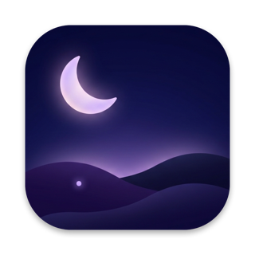
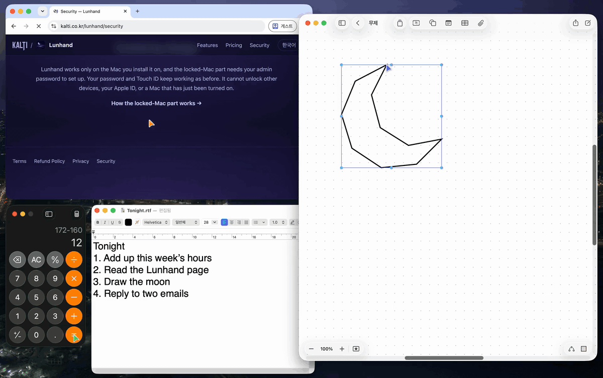

  

<h1 align="center">Lunhand</h1>

  <b>맥에서 일하는 AI 에이전트의 손</b> 
  AI 에이전트가 맥 앱을 백그라운드에서 조작하게 해 주는 macOS용 컴퓨터 사용(computer use) MCP 서버. 맥이 잠겨 있어도 맡긴 일을 계속합니다.

  <a href="README.md">English</a> · <b>한국어</b>

  <a href="https://kalti.co.kr/ko/lunhand/"><b>사이트·구매</b></a> ·
  <a href="https://github.com/kalti-lab/lunhand/releases/latest"><b>내려받기</b></a>

  
   
  AI 세션 넷이 앱 하나씩 맡아 동시에 일하는 모습. 계산기로 일한 시간을 더하고, 텍스트 편집기에 할 일을 치고, 크롬에서 kalti.co.kr을 읽고, Freeform에 달과 언덕을 그린다. 세션마다 커서 색이 다르다(가상 커서 켬, 2배속, 20초).

이 저장소는 Lunhand 설치 파일을 올리는 곳입니다. 소스 코드는 공개하지 않습니다.

## 설치

1. [kalti.co.kr/ko/lunhand](https://kalti.co.kr/ko/lunhand/)에서 구매합니다. 라이선스 키는 메일로 갑니다.
2. [Releases](https://github.com/kalti-lab/lunhand/releases/latest)에서 최신 `Lunhand-<판>.pkg`를 내려받아 엽니다.
3. 설치하면 설정 창이 라이선스 키와 macOS 권한 두 개를 차례로 안내합니다.

필요한 것: Apple Silicon 맥, macOS 14.4 이상.

Lunhand는 하루에 한 번 업데이트를 확인하고, 설정 창 맨 아래 'Check for Updates'를 누르면 바로 확인합니다. 지우려면 터미널에서 `/Applications/Lunhand.app/Contents/Resources/uninstall.sh`를
실행합니다. 이때 이 맥이 쓰던 라이선스 자리도 풀립니다.

## 설치 전에 확인하세요

- 잠긴 맥에서 일하는 기능은 일하는 동안 비밀번호 없이 맥 잠금을 풉니다. 그동안 화면은 덮개로 가리고, 일이 끝나면 다시 잠급니다.
- 내 macOS 계정으로 도는 프로그램이면 무엇이든 Lunhand에게 일을 시킬 수 있고, 잠긴 맥에서도 마찬가지입니다. 잠긴 맥에서 일하는 다른 컴퓨터 사용 도구도 같습니다.
- 내가 가진 맥에, 믿을 수 있는 장소에서, 믿을 수 있는 프로그램만 쓰는 맥에만 설치하세요. 회사 맥이면 회사 보안 규정부터 확인하세요.
- 잠긴 맥에서 일하는 기능은 빼고 설치할 수 있습니다. 설치 프로그램에서 '잠긴 맥에서 일하기' 체크를 끄면 됩니다.
- 자세한 내용: [kalti.co.kr/ko/lunhand/security](https://kalti.co.kr/ko/lunhand/security)

## 문의

[support@kalti.co.kr](mailto:support@kalti.co.kr)

## 라이선스

© 2026 KALTI Works. All rights reserved.

Lunhand는 상용 소프트웨어이며 [이용약관](https://kalti.co.kr/ko/lunhand/terms)에 따라 씁니다.
서면 허락 없이 이 소프트웨어의 전부 또는 일부를 복제·수정·배포·판매할 수 없습니다.

Lunhand는 독립 프로젝트이며 Apple, Anthropic, OpenAI, Notion, Figma와 제휴하거나 보증을 받지 않았습니다.
Claude, Codex, ChatGPT, Notion, Figma, macOS는 각 소유자의 상표입니다.
