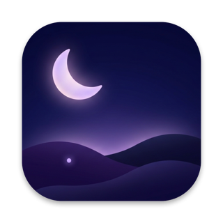
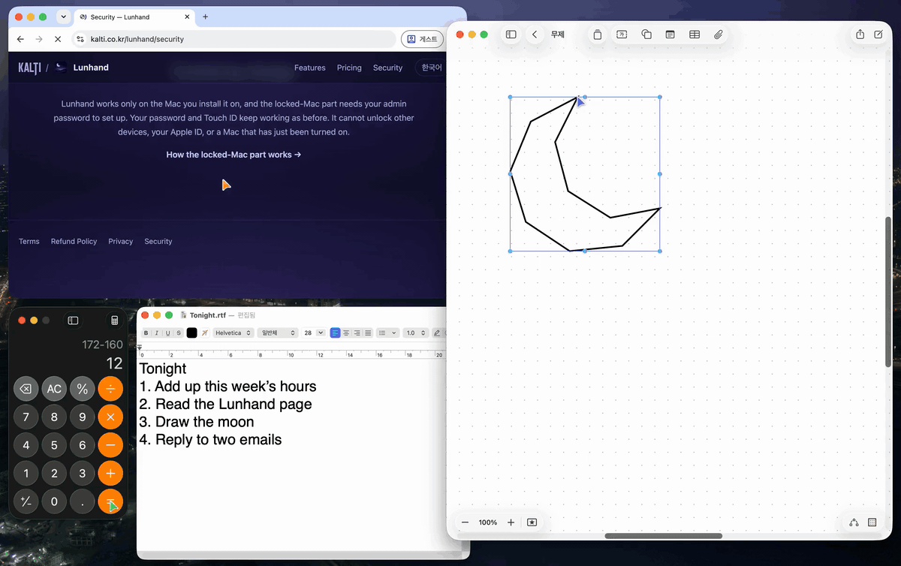

  

<h1 align="center">Lunhand</h1>

  <b>Hands for your AI agent on the Mac</b> 
  A computer-use MCP server for macOS that lets your AI agent use your apps in the background, even while your Mac is locked.

  <b>English</b> · <a href="README.ko.md">한국어</a>

  <a href="https://kalti.co.kr/lunhand/"><b>Website and purchase</b></a> ·
  <a href="https://github.com/kalti-lab/lunhand/releases/latest"><b>Download</b></a>

  
   
  Four AI sessions work at the same time, each in its own app and with its own cursor color: one adds up hours in Calculator, one types a to-do list in TextEdit, one reads kalti.co.kr in Chrome, and one draws a moon and hills in Freeform (virtual cursor on, 2× speed, 20 seconds).

Works with Claude Code, Claude Desktop, Codex, the Antigravity CLI and other MCP clients. Lunhand connects itself to the
ones it finds on your Mac, and the setup window turns each on or off.

This repository is where Lunhand's installers are published. The source code is not public.

## Install

1. Buy Lunhand at [kalti.co.kr/lunhand](https://kalti.co.kr/lunhand/). Your license key comes by email.
2. Download the latest `Lunhand-<version>.pkg` from [Releases](https://github.com/kalti-lab/lunhand/releases/latest) and open it.
3. After you install, the setup window walks you through your license key and two macOS permissions.

Requirements: an Apple silicon Mac with macOS 14.4 or later.

Lunhand checks for updates once a day, and Check for Updates at the bottom of the settings window checks right away. To remove it, run `/Applications/Lunhand.app/Contents/Resources/uninstall.sh`
in Terminal. This also frees the Mac's place on your license key.

## Before you install

- While it works, the locked-Mac feature unlocks your Mac without your password. The screen stays covered, and the Mac locks again when the work is done.
- Any program that runs under your macOS account can ask Lunhand to act, including on a locked Mac. Other computer-use tools that work on a locked Mac have the same property.
- Install it only on a Mac you own, in a place you trust, that runs only software you trust. If it is a work Mac, check your company's security rules first.
- You can install without the locked-Mac feature: in the installer, uncheck "Work on a locked Mac".
- Details: [kalti.co.kr/lunhand/security](https://kalti.co.kr/lunhand/security)

## Support

[support@kalti.co.kr](mailto:support@kalti.co.kr)

## License

© 2026 KALTI Works. All rights reserved.

Lunhand is commercial software. Its use is governed by the [Terms](https://kalti.co.kr/lunhand/terms).
No license is granted to copy, modify, distribute, or sell it, in whole or in part, without prior written permission.

Lunhand is an independent project and is not affiliated with, endorsed by, or sponsored by
Apple, Anthropic, OpenAI, Notion Labs, or Figma. Claude, Codex, ChatGPT, Notion, Figma,
and macOS are trademarks of their respective owners.
